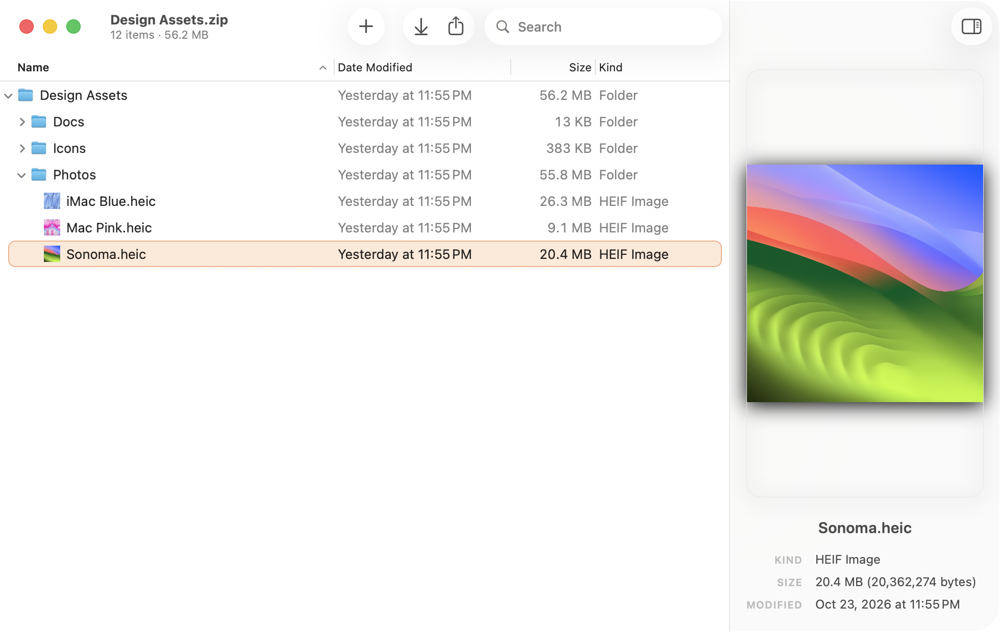
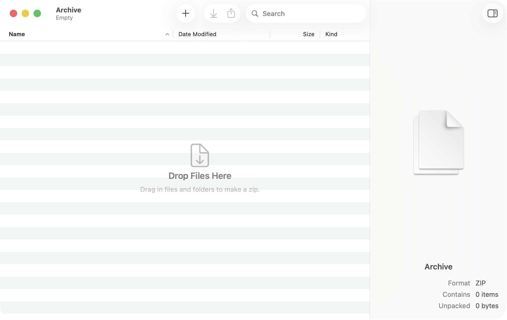
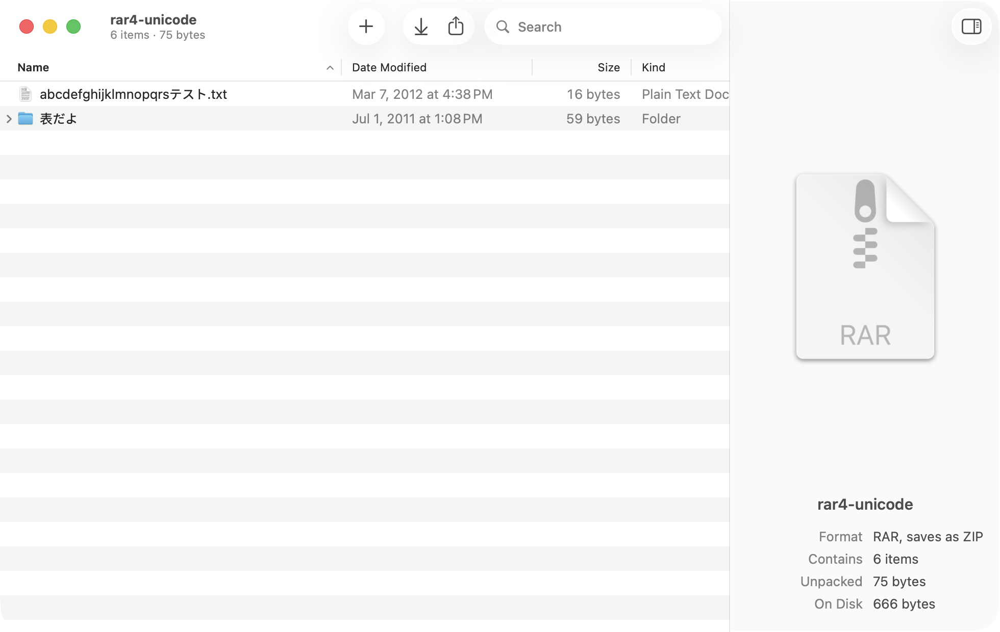

<p align="center"></p>

# Zipboy

Archives, without the ceremony. Open a ZIP, RAR, 7z, or tarball and it reads like a Finder window:
look inside, preview anything, drag files in and out. There's no Save step. Your changes are kept
as you go.

<picture>
  <source media="(prefers-color-scheme: dark)" srcset="docs/screenshots/browse-dark.png">
  
</picture>

## Install

1. Download the newest `Zipboy-….dmg` from the [Releases page](https://github.com/oddurs/zipboy/releases).
2. Open it, and drag **Zipboy** onto **Applications**.
3. Open Zipboy from Applications. The first time, macOS says it can't check it for malicious software,
   because Zipboy isn't notarized by Apple yet. Click **Done**, open **System Settings › Privacy &
   Security**, scroll to **Security**, and click **Open Anyway** next to Zipboy. You only do this once.

Zipboy needs macOS 14 Sonoma or later, on Apple silicon or Intel.

## What it does

- **Look inside.** A Finder-style list with thumbnails, search, and a live preview beside it. Press
  Space for Quick Look.
- **Change anything.** Drop files onto any folder, paste, rename in place, make folders, move things
  around, delete. Every change can be undone, and each one saves itself, with versions to go back to.
- **Edit in place.** Double-click a file to open it in its app. Save it there and the archive keeps
  the change.
- **Take things out.** Drag items to Finder, or click Extract to unpack next to the archive. A
  single folder comes out as itself, never a folder inside a folder.
- **Make a zip.** Drop files or folders on the Dock icon, or start a New Archive and drag them in.
- **RAR, 7z, and tar** open as a new ZIP named after the original. The original is never changed.
- **Passwords.** Protected ZIPs ask once. Set Password… in the File menu encrypts with AES-256.

<picture>
  <source media="(prefers-color-scheme: dark)" srcset="docs/screenshots/empty-dark.png">
  
</picture>
<picture>
  <source media="(prefers-color-scheme: dark)" srcset="docs/screenshots/import-dark.png">
  
</picture>

## What it opens

Every row is a file in `Tests/ZipboyKitTests/Fixtures/matrix`, opened by the test suite on every change.

| Format | Opens | Doesn't open |
|---|---|---|
| ZIP | stored, Deflate, bzip2, LZMA, Zip64, streamed, Windows paths, symlinks, old Windows names (code page 437), and passwords (ZipCrypto, AES-128, AES-256) | Deflate64, which Windows uses for files over 2 GB |
| RAR | RAR4 and RAR5, including solid RAR5, with Unicode names and symlinks | encrypted RAR |
| 7z | LZMA, LZMA2, PPMd, BZip2, Deflate, uncompressed, BCJ, solid | encrypted 7z |
| tar | plain and pax, compressed with gzip, bzip2, xz, or lzma | zstd, on a Mac without the `zstd` tool |
| Others | cpio, ISO 9660 | a single gzipped file that isn't an archive |

Zipboy writes ZIP only. Reading and writing go through the libarchive that ships with macOS, so there
are no dependencies. Entries that would land outside the archive, through `..`, absolute paths, or
symlinks, are skipped. `__MACOSX`, `._*`, and `.DS_Store` are left out both ways.

## Build

Requires macOS 14 and Swift 6 (Command Line Tools are enough).

```sh
scripts/task build              # build/Zipboy.app, universal, ad hoc signed
scripts/task check              # format check, lint, tests, build
scripts/task package 0.1.0      # build/Zipboy-0.1.0.dmg, as a release ships it
```

## License

Zipboy is released under the [MIT License](LICENSE). The test fixtures from libarchive and Homebrew keep
their own BSD licenses, credited in `Tests/ZipboyKitTests/Fixtures/README.md`.
